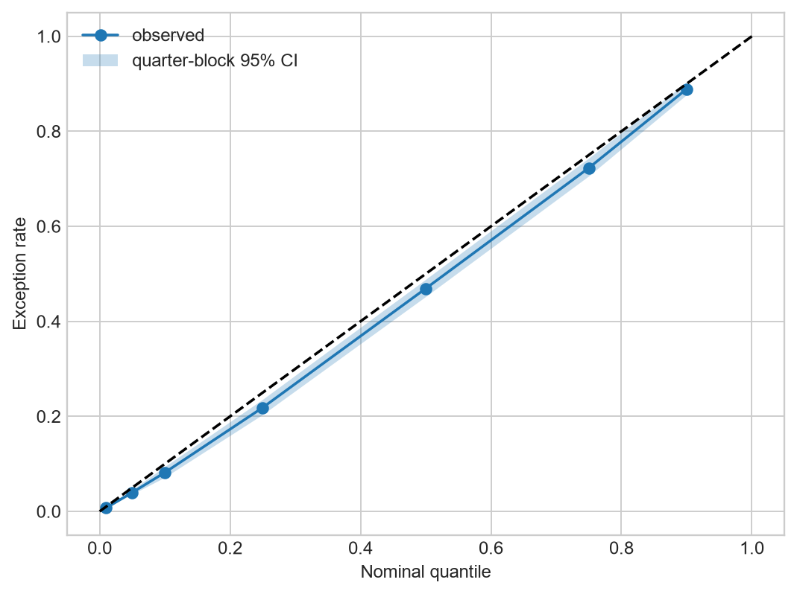
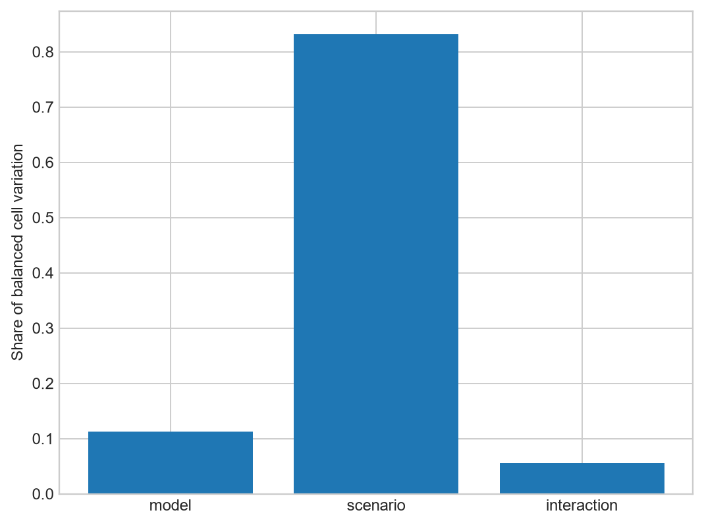

# TreasuryShield-MRM

TreasuryShield-MRM is an end-to-end model-risk and liquidity-stress research project for U.S. commercial banks. It combines point-in-time-aware public regulatory data, distributional forecasting, challenger validation, stress and reverse-stress analysis, recovery optimization, and a monitoring state machine.

The project is a research implementation built from public data and public-data proxies. It is not a regulatory LCR/NSFR implementation, a production decision system, an estimate of any bank's internal liquidity position, or evidence of causal effects.

## Research framing

The central question is not simply which model posts the lowest aggregate loss. The study asks whether a more complex regime-aware framework adds stable out-of-time value after leakage controls, crisis holdouts, clustered inference, calibration analysis, subgroup testing, operational burden, and independent challenge are considered.

The model inventory spans historical and peer quantiles, persistence, OLS and panel fixed effects, linear quantile regression, quantile forests, CUDA XGBoost, CPU LightGBM, a Bayesian Student-t challenger, CUDA MLP/GRU models, and tree/neural RAHQ and RAHQ-C variants. The evidence did not support assuming that RAHQ-C would win: the frozen champion is the simpler **B8 LightGBM quantile model**, with an independent project recommendation of **ACCEPT WITH LIMITATIONS**.

## Data and point-in-time design

The frozen snapshot `fbc0b7b5a2c46fbcc0b5` contains 425 validated official-source files. The long Core Panel covers 1,384,379 commercial-bank quarters from 1984Q1 through 2026Q1. The Enhanced Panel uses FFIEC 031/041/051 bulk data from 2017Q1 onward. Separate extensions use FDIC institution/event data, Federal Reserve H.8, FRED/ALFRED macro data, and FR Y-9C holding-company data.

The pipeline distinguishes report period, public availability date, source vintage, retrieval date, target availability, and forecast origin. It enforces `feature_information_date <= forecast_origin`, fits preprocessing, peers, and regimes within training partitions, uses filtered rather than future-aware smoothed regime probabilities, and excludes material M&A windows in the primary analysis. Current corrected filings and pseudo-point-in-time macro vintages are kept conceptually separate; exact historical Call Report amendment vintages cannot always be reconstructed.

Source scope, URLs, retrieval metadata, and caveats are documented in [the data-source review](desktop_study/data_source_review.md) and public manifests under [`data/manifests/`](data/manifests/).

## Architecture and validation boundary

The workflow runs from official-source acquisition through data contracts, feature and target construction, temporal validation, model development, independent validation, stress translation, recovery optimization, monitoring, and reporting. Development logic and independent validation logic live in separate modules under [`src/treasuryshield/`](src/treasuryshield/).

Random splitting is retained only as a negative control. Primary evidence comes from temporal out-of-time tests, full crisis/regime holdouts, and a final locked 2024+ forecast-origin holdout. Model selection, preprocessing choices, acceptance gates, and the final comparison roster were frozen before that holdout was scored. The locked sample contains 30,087 rows across 4,017 banks and eight quarters.

## Validation-hardened v1.2 findings

- B8 LightGBM remains the frozen champion; v1.2 did not retune it, replace it, or rewrite historical results.
- The v1.2 aligned panel-calibration analysis reports a Q05 exception rate of **3.975%** against a nominal 5%, with a whole-quarter-block 95% interval of **3.501%–4.441%**. The lower-than-nominal exception rate is conservative miscalibration, not evidence of exact calibration. The original frozen v1 metric remains 3.995%.
- Only eight locked-period quarters are available, so temporal inference is low-resolution even when all banks within a quarter are resampled together.
- At a 10% review budget, the frozen combined selective-review policy captured **28.61% of severe tail misses**, a **2.86x** lift over random 10% review. This is capture, not a 28.61% increase in model accuracy.
- Robust slice analysis identifies **19 material slices** with persistent Q05 coverage deviation after minimum-exposure, bank-count, time-span, clustered-inference, and multiplicity controls.
- An earlier nominal GRU challenger reversal in one asset slice did not survive quarter clustering, two-way inference, and Holm adjustment; it is not treated as a stable challenger win.
- Peak Funding Need proxy variance attribution is **83.22% scenario assumptions**, **11.27% model choice**, and **5.51% model-by-scenario interaction**. Scenario design dominates model choice in this balanced research design.
- The historical monitoring replay achieved **100% recall** and **45.8% precision**. That tradeoff catches all defined adverse quarters but produces meaningful false-alert burden.
- Reconstructing the frozen seven-quantile LightGBM recipe produced a maximum absolute prediction difference of **0** over **30,087 locked rows × 7 quantiles**. Exact TreeSHAP explanations are therefore labeled against the reproduced model rather than a surrogate.





## Stress, reverse stress, and recovery

Forecast distributions feed transparent research proxies for deposit runoff, funding substitution, liquid-asset drawdown, securities haircuts, secured-funding capacity, and commitment draws. H.8 supplies aggregate weekly path shapes only; it is never treated as bank-level weekly data.

The stress layer reports Peak Funding Need, maximum shortfall, shortfall probability, buffer use, liquidity runway, and recovery cost. It compares dependence assumptions, explores capital-liquidity feedback as a sensitivity proxy, searches reverse-stress frontiers, and compares heuristic with constrained optimized recovery actions. These are research stress scenarios and public-data proxies, not internal regulatory liquidity measures.

## Monitoring and governance

The monitoring state machine moves through `GREEN`, `WATCH`, `REVIEW`, `RECALIBRATE`, and `REDEVELOP`. Thresholds were fit on pre-2024 evidence. Escalation considers tail loss, coverage, miss severity, drift/OOD, missingness, and challenger disagreement; hysteresis governs de-escalation. The backtest supports monitoring design research, not production threshold approval.

The independent validator's limitations and failure analysis are in [the validation report](reports/06_independent_validation_report.html) and [v1.2 hardening report](reports/v1_2/01_validation_hardening_report.html).

## Reproducibility

### Portable public checks

The public repository intentionally excludes raw filings, processed bank-level datasets, prediction-level outputs, fitted artifacts, local state, and the 1.47 GB results warehouse. A clean clone can run the same portable checks used by GitHub Actions:

```powershell
python -m venv .venv
.\.venv\Scripts\python.exe -m pip install -r requirements-ci.txt
$env:PYTHONPATH = "src"
.\.venv\Scripts\python.exe -m compileall -q src tests/test_panel_fixed_effects.py tests/test_stress_arithmetic.py tests/test_temporal_integrity.py
.\.venv\Scripts\python.exe -m pytest -q tests/test_panel_fixed_effects.py tests/test_stress_arithmetic.py tests/test_temporal_integrity.py
```

On Linux/macOS, replace `.\.venv\Scripts\python.exe` with `.venv/bin/python` and set `PYTHONPATH=src`.

### Full local validation

With the frozen local snapshot and excluded artifacts present, the canonical validation sequence is:

```powershell
.\.venv\Scripts\python.exe -m treasuryshield.v11.pipeline
.\.venv\Scripts\python.exe -m pytest -q
.\.venv\Scripts\python.exe -m treasuryshield.v12.finalize
```

The v1.2 release passed all **39 local tests**. The first command is resume-safe and does not recompute a completed v1.1 run. The full evidence trail is described in [the v1 reproducibility manifest](reports/10_reproducibility_manifest.md) and [the v1.2 manifest](reports/v1_2/08_v1_2_reproducibility_manifest.md).

### What public CI does—and does not do

GitHub-hosted CI runs on Python 3.12 for Windows and Ubuntu. It compiles the public source, imports the package, and runs nine portable tests covering within-bank panel estimation, stress/recovery arithmetic, quarterization, forecast-origin alignment, filtered-regime invariance, and adaptive-calibration maturity.

CI does not claim to rerun the 39-test research validation or regenerate empirical findings without the excluded frozen data and artifacts. Reports and selected figures provide public evidence; the release bundle curates the highest-value outputs.

## Repository map

| Path | Purpose |
|---|---|
| `src/treasuryshield/` | Acquisition, preprocessing, modeling, stress, validation, monitoring, and reporting code |
| `tests/` | Portable tests plus artifact-backed v1.1/v1.2 integrity tests |
| `desktop_study/` | Regulatory, Treasury-domain, model-risk, and source research |
| `data/manifests/` | Public metadata, schemas, registries, quality summaries, URLs, and hashes |
| `reports/` | Development, validation, stress, monitoring, executive, and reproducibility reports |
| `figures/` | Publication figures with manifests |
| `.github/workflows/ci.yml` | Portable public CI |

## Limitations

Public filings do not expose contractual cash-flow ladders, depositor concentration, collateral encumbrance, committed facilities, internal behavioral assumptions, or exact historical amendment vintages. The final temporal sample contains only eight quarters. Several v1.2 analyses are post-hoc hardening diagnostics under frozen policies, not a second confirmatory model-selection exercise. Findings are predictive associations and sensitivity results, not causal estimates. Prospective evidence is required before any production use.

## Release history

- **v1.2.0** — validation hardening, robust clustered calibration/slicing, corrected challenger inference, actual-engine stress attribution, monitoring state machine, exact LightGBM reproduction, and TreeSHAP.
- **v1.1** — post-model calibration, slicing, drift/OOD, selective review, stress attribution, and monitoring diagnostics.
- **v1** — end-to-end frozen research study and independent validation.

See [CHANGELOG.md](CHANGELOG.md) and [RELEASE_NOTES_v1.2.0.md](RELEASE_NOTES_v1.2.0.md).

## License status

No license file has been selected. Publication of the source does not itself grant reuse rights; licensing remains intentionally unchanged pending an owner decision.
